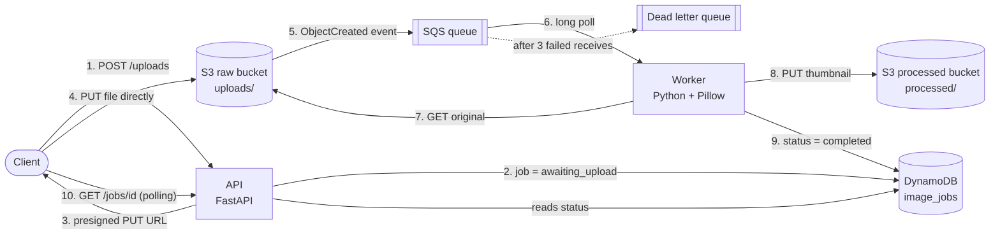

# Event-Driven Image Pipeline: S3, SQS, DynamoDB

Project 8 of a hands-on DevOps and system design learning track. Where the URL shortener (Project 7) answered every request immediately, this project handles work that is **slow**: the API accepts an upload and responds at once, and a separate worker processes the image in the background. The two sides never talk to each other directly. They are decoupled by a queue.

Infrastructure is Terraform (in the `image-pipeline-infra` repo). The API and worker are Python (this repo).

---

## Architecture



---

## Design decisions

**The file bytes never touch the queue or the API.** Queues are built for small messages and a photo is far larger than the limit. The API hands the client a **presigned S3 URL**, a temporary signed link that allows exactly one upload to one key, and the client uploads straight to S3. The API never proxies the file, so a large upload can't tie up an app server.

**S3 announces the upload, not the API.** The first draft had the API enqueue the job right after issuing the presigned URL. That is a race: a worker could receive the message and look for the file before the client finished uploading it. Using an **S3 event notification** (`ObjectCreated` to SQS) means a message exists only after the object does. The job's DynamoDB record starts as `awaiting_upload`, so polling works from the first second.

**Polling, not webhooks.** The client is a browser, which cannot host an endpoint for a webhook to call. A status check is one cheap key lookup.

**DynamoDB for job status.** Every access is a lookup by `job_id`: no joins, no relationships. It is serverless, pay-per-request, and a TTL attribute (`expires_at`, epoch seconds) removes old records automatically. Redis was rejected because an in-memory restart could silently lose a job record.

**At-least-once delivery, so idempotent processing.** If a worker crashes after processing but before deleting its message, SQS redelivers it after the visibility timeout. Reprocessing must therefore be safe:
- The output key is deterministic (`processed/{job_id}.jpg`), so a rerun overwrites the same file.
- Status writes are absolute (`status = completed`), never increments.
- A conditional update skips jobs that are already `completed`.

**Dead letter queue.** A message that fails 3 times moves to a DLQ instead of looping forever. A corrupt image is a *poison message*: retrying never helps, so it is set aside for inspection.

**Separate buckets plus a prefix filter.** If processed output landed anywhere that triggers the notification, every result would enqueue another job in an endless billable loop. Raw and processed files live in different buckets, and the notification only fires on `uploads/`.

---

## Infrastructure (Terraform)

| File | Contents |
|---|---|
| `provider.tf` | AWS provider, `ap-south-1` |
| `s3.tf` | Raw and processed buckets (account ID in the name for global uniqueness), public access blocked |
| `dynamodb.tf` | `image_jobs` table, `job_id` partition key, TTL on `expires_at` |
| `sqs.tf` | Main queue (60s visibility timeout, 20s long polling), DLQ (`maxReceiveCount = 3`), and a queue policy letting S3 send to it, scoped to the raw bucket's ARN |
| `events.tf` | S3 notification to SQS, filtered to `uploads/`, with `depends_on` the queue policy |
| `outputs.tf` | Bucket names, queue URLs, table name |

The queue policy is a **resource-based** policy (attached to the queue, naming who may send to it), unlike the identity-based IAM policies attached to users and roles. S3 is a service, not a user, so the queue must grant it access explicitly.

---

## Running it

```bash
# infrastructure
cd image-pipeline-infra
terraform init && terraform apply

# app (each terminal)
cd image-pipeline
source venv/bin/activate && source env.sh    # env.sh reads Terraform outputs

uvicorn api:app --reload                     # terminal 1
python worker.py                             # terminal 2
```

End-to-end test:
```bash
RESP=$(curl -s -X POST localhost:8000/uploads -H "Content-Type: application/json" -d '{"content_type":"image/jpeg"}')
JOB_ID=$(echo $RESP | jq -r .job_id)
curl -X PUT "$(echo $RESP | jq -r .upload_url)" -H "Content-Type: image/jpeg" --data-binary @big.jpg
curl -s localhost:8000/jobs/$JOB_ID | jq     # processing, then completed + result_url
```

A 2000x1500 test image came back from the pipeline as 800x600, confirming the full chain: presigned upload, S3 event, SQS, worker, S3, DynamoDB, polling.

---

## Gotchas

| Symptom | Cause | Fix |
|---|---|---|
| Job stuck at `awaiting_upload` after an upload that printed nothing | The presigned URL used S3's global endpoint, and S3 answered the PUT with `307 Temporary Redirect`. `curl` doesn't follow it (and following it breaks the signature, which covers the host), so the file never arrived | Pin the regional endpoint in the boto3 client: `endpoint_url=https://s3.<region>.amazonaws.com`, SigV4, virtual-hosted addressing |
| `SignatureDoesNotMatch` on upload | The `Content-Type` sent differs from the one signed into the URL | Send the same `Content-Type` declared at `POST /uploads` |
| S3 notification creation fails | S3 validates it can send to the queue, and the queue policy didn't exist yet | `depends_on` the queue policy |
| DynamoDB syntax error on `status` or `error` | Both are reserved words in expressions | Use `ExpressionAttributeNames` (`#s`, `#e`) |
| Worker crash on first startup | S3 sends a one-off `s3:TestEvent` with no `Records` | Iterate over `body.get("Records", [])`, so it is skipped and deleted |

---

## Scope and known gaps

- **The worker runs locally against the real AWS services**, using admin credentials. It is not deployed. Production would run it as a container, Lambda function, or Auto Scaling group on a role holding only the least-privilege permissions below, scaling on queue depth rather than CPU.
- Least-privilege split: the API needs `dynamodb:PutItem/GetItem`, `s3:PutObject` on raw and `s3:GetObject` on processed. The worker needs `sqs:ReceiveMessage/DeleteMessage`, `s3:GetObject` on raw, `s3:PutObject` on processed, and `dynamodb:UpdateItem`.
- A presigned PUT cannot limit file size. Presigned POST with a `content-length-range` condition would.
- Browser uploads would need CORS on the raw bucket. Testing here used `curl`.
- No authentication on the API, no alarm on the DLQ, single region.
- Optional extension: publish the S3 event to an **SNS** topic that fans out to several queues (resize, thumbnail, analytics), each with its own workers.

## Cost and teardown

S3, SQS, and DynamoDB bill per use, so a test session costs pennies. Tear down anyway:
```bash
terraform destroy
```
(`force_destroy = true` on the buckets lets this succeed even with files inside.)

---

## Status

- [x] HLD and LLD designed, including a race condition found and fixed at design time
- [x] Terraform: buckets, DynamoDB, SQS + DLQ, S3 notification
- [x] API (`/uploads`, `/jobs/{id}`) and worker built
- [x] Happy path verified end to end (2000x1500 in, 800x600 out)
- [ ] Failure path (corrupt upload: 3 retries, job `failed`, message in the DLQ). Verify, then tick
- [ ] Worker deployed (EC2, Lambda, or Kubernetes)
- [ ] SNS fan-out extension
